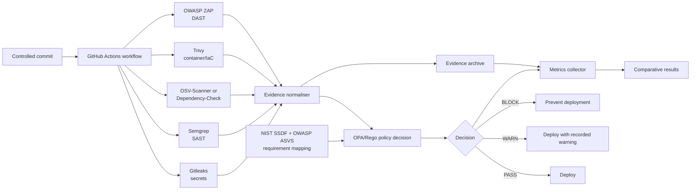

# Policy-as-Code Security Gates for CI/CD Pipelines

## Working title

**Policy-as-Code Security Gates for CI/CD Pipelines: Operationalising NIST SSDF
and OWASP ASVS for Early Vulnerability Detection**

## Problem statement

Modern CI/CD pipelines increasingly integrate secret detection, static
application security testing (SAST), software composition analysis (SCA),
container scanning, and dynamic application security testing (DAST).
However, these tools commonly run as independent tasks with tool-specific
outputs and thresholds rather than as one consistent security decision
framework.

NIST SSDF defines secure-development practices and OWASP ASVS provides
technical verification requirements, but translating these requirements into
reproducible, machine-enforceable CI/CD decisions remains an implementation
and evaluation challenge. A pipeline may produce security findings without
establishing which requirement each finding supports, when a finding should
warn or block, or whether the resulting control prevents a vulnerable
deployment.

This project therefore investigates a policy-as-code security-gate framework
that aggregates evidence from heterogeneous open-source security tools,
maintains traceability to selected NIST SSDF and OWASP ASVS requirements, and
produces explicit `PASS`, `WARN`, or `BLOCK` decisions. The framework will be
evaluated through a controlled comparative experiment using identical
vulnerable commits in a baseline pipeline and the proposed pipeline.

## Research questions

### Main research question

**To what extent can an SSDLC-derived policy-as-code security gate framework
improve early vulnerability detection and prevent vulnerable deployments in
CI/CD pipelines compared with a traditional late-stage security approach,
while maintaining acceptable pipeline overhead?**

### Supporting questions

**RQ1.** How can selected NIST SSDF and OWASP ASVS requirements be translated
into machine-enforceable security-gate policies within GitHub Actions?

**RQ2.** How does the proposed framework affect vulnerability detection rate,
stage of first detection, time-to-security-feedback, and vulnerable
deployments prevented?

**RQ3.** What CI/CD overhead and false-positive cost are introduced by the
proposed security gates?

## Objectives

1. Select and justify a bounded set of NIST SSDF practices and OWASP ASVS
   verification requirements relevant to CI/CD security gates.
2. Define a traceable policy model that maps requirements to scanner evidence,
   severity thresholds, gate outcomes, and deployment decisions.
3. Implement a reproducible GitHub Actions prototype using open-source
   security tools and a central OPA/Rego decision layer.
4. Construct controlled commits with known ground truth covering exposed
   secrets, vulnerable dependencies, code vulnerabilities, container
   vulnerabilities, and runtime web vulnerabilities.
5. Execute identical commits through a traditional late-stage baseline and
   the proposed multi-stage pipeline.
6. Measure detection rate, first-detection stage, time-to-security-feedback,
   vulnerable deployments prevented, false positives, and added execution
   time.
7. Analyse the security/performance trade-off, limitations, and the conditions
   under which the framework is effective.

## Contribution and novelty

The contribution is not the simple integration of several scanners. It is the
design and experimental evaluation of a traceable decision framework that:

- operationalises selected SSDLC requirements as machine-enforceable policies;
- normalises heterogeneous scanner evidence into a common finding model;
- makes explicit, reproducible `PASS`, `WARN`, and `BLOCK` decisions;
- links each decision to a secure-development requirement;
- evaluates security outcomes and operational cost using identical controlled
  commits and known ground truth.

The existing Kubernetes/Conftest/Gatekeeper work remains useful as a
Policy-as-Code and admission-control foundation, but it is no longer the
complete project contribution. The new experiment must extend the governed
artefacts and evaluation to CI/CD security gates.

## Proposed architecture

The baseline pipeline preserves the same application build, test, and
deployment flow but runs security checks only at the late stage. The proposed
pipeline runs the identical commit and flow, but executes the mapped security
checks after each relevant stage before the next stage is allowed to proceed.
Both pipelines record the same timestamps, findings, and deployment outcome
fields.

## Candidate policy and gate model

The following is the initial policy model to agree before implementation.
Thresholds are experimental parameters and must be fixed before running the
comparative experiment.

| Gate | Evidence | Default decision |
|---|---|---|
| Secret exposure | Verified high-confidence secret finding | `BLOCK` |
| Source vulnerability | Semgrep finding at configured severity | `BLOCK` for medium/high/critical |
| Dependency vulnerability | OSV-Scanner/Dependency-Check finding with severity and fix data | `BLOCK` for medium/high/critical |
| Container vulnerability | Trivy finding in the built image | `BLOCK` for medium/high/critical |
| Runtime web vulnerability | ZAP alert at configured risk level | `BLOCK` for medium/high/critical |
| Tool failure or missing evidence | Scanner did not complete or produced no parseable result | `BLOCK` for required gates |

`PASS` means all required gates pass. `WARN` means the finding is recorded and
the deployment is allowed under the declared threshold. `BLOCK` means the
deployment is prevented. Every decision must include the gate, requirement
identifier, finding identifier, severity, source tool, and policy version.

## Agreed experimental decisions

- OWASP ASVS version: **4.0.3**
- Primary SCA tool: **OWASP Dependency-Check**
- Medium, high, and critical findings: **BLOCK**
- Low findings: **WARN** or `PASS` according to the final gate-specific rule,
  which must be fixed before the experiment.
- Baseline: same build/test/deploy flow, with security checks only at the
  late stage.
- Proposed pipeline: same flow and identical commits, with security checks
  after each relevant stage.

## Initial requirement-to-gate mapping

This is a candidate mapping, not yet an implementation specification. The
exact requirement wording and identifiers must be pinned to the selected NIST
SSDF and OWASP ASVS versions before the experiment.

| Gate | NIST SSDF alignment | OWASP ASVS alignment | Evidence | Decision under test |
|---|---|---|---|---|
| Secrets | PW.5: secure source code and configuration | V6: stored cryptography and secret handling | Gitleaks finding, verified fixture label | Secret exposure blocks |
| SAST | PW.7: review and analyse human-readable code | V5: validation, sanitisation, and encoding | Semgrep rule ID, location, severity | High/critical code flaw blocks |
| Dependencies | PS.3: generate and maintain well-secured components | V1/V14: architecture and configuration verification | OSV/Dependency-Check advisory, package, version, severity | High/critical known dependency flaw blocks |
| Container | PW.6: configure compilation, packaging, and release | V14: configuration and operational security | Trivy image finding, image digest, severity | High/critical image flaw blocks |
| Runtime web | RV.1: identify and confirm vulnerabilities | V1/V4/V5: architecture, access control, and validation verification | ZAP alert, URL, risk, confidence | High/critical runtime alert blocks |
| Decision integrity | PO.3/PW.1: maintain traceability and secure development practices | V14: configuration and operational security | Signed/versioned evidence and policy decision record | Missing or invalid evidence blocks |

The mapping deliberately distinguishes framework alignment from direct
equivalence: a scanner finding is evidence supporting a requirement, not proof
that the entire requirement has been satisfied.

## Controlled comparative experiment

The experiment is a **controlled comparative experiment**, not a simulation.

The fixture catalogue and ground-truth contract are defined in
[controlled-fixtures.md](controlled-fixtures.md).

The common scanner evidence and OPA decision contract is defined in
[evidence-and-decision-schema.md](evidence-and-decision-schema.md).

Each vulnerability fixture is introduced in a separate commit with a known
ground-truth label. The same commit is executed through:

1. **Baseline:** build/test and late-stage security checks, followed by the
   deployment decision.
2. **Proposed framework:** staged security gates, evidence normalisation,
   OPA/Rego decision, and deployment decision.

The minimum fixture families are:

- exposed secret;
- vulnerable direct or transitive dependency;
- source-code vulnerability;
- vulnerable container image or insecure container configuration;
- runtime web vulnerability;
- clean control commits for false-positive measurement.

## Evaluation metrics

| Metric | Definition |
|---|---|
| Vulnerability detection rate | Ground-truth vulnerabilities detected by a pipeline divided by all ground-truth vulnerabilities |
| Stage of first detection | Earliest pipeline stage that reports each vulnerability |
| Time-to-security-feedback | Time from workflow start or vulnerable commit execution to first actionable finding |
| Vulnerable deployments prevented | Ground-truth vulnerable commits blocked before deployment |
| False positives | Findings reported on clean controls or findings not supported by the fixture ground truth |
| Pipeline overhead | Additional wall-clock execution time and, where available, GitHub Actions resource use |
| Decision consistency | Agreement between normalised evidence, Rego decision, and recorded deployment outcome |

## Work sequence

1. Agree the requirement versions, mapping, gate thresholds, and baseline
   definition.
2. Create the controlled vulnerability fixture catalogue and ground-truth
   table.
3. Define the common finding schema and evidence contract.
4. Implement the central policy decision logic and unit tests.
5. Add scanners incrementally to GitHub Actions.
6. Execute the baseline and proposed pipelines on identical commits.
7. Analyse results and update the dissertation.

No scanner integration should be treated as final until steps 1–3 are
approved, because the mapping and decision logic are the research artefact.

## Literature review seed table

| Source | Relevance to this project | Use in literature review |
|---|---|---|
| *in-toto: Providing Farm-to-Table Guarantees for Bits and Bytes*, USENIX Security 2019 | Demonstrates enforceable software-supply-chain requirements and verifiable evidence | Justifies traceability and evidence-based security decisions |
| *Resource Usage and Optimization Opportunities in Workflows of GitHub Actions*, ICSE 2024 | Provides large-scale workflow/job resource data and an evaluation approach | Informs overhead and resource-use measurement |
| *Why Do GitHub Actions Workflows Fail? An Empirical Study*, ACM TOSEM 2026 | Separates workflow failures from security-tool or policy failures | Informs failure classification and experimental validity |
| *Small World with High Risks: A Study of Security Threats in the npm Ecosystem*, USENIX Security 2019 | Establishes the practical importance of dependency and ecosystem risk | Supports the SCA gate and dependency fixture design |
| *Quantifying Security Issues in Reusable JavaScript Actions in GitHub Workflows*, MSR 2024 | Shows security risks introduced by workflow/action dependencies | Supports treating GitHub Actions as part of the governed CI/CD surface |
| NIST SSDF and NIST SP 800-204D | Provides secure-development and DevSecOps supply-chain practice context | Defines the SSDLC basis for the policy mapping |
| OWASP ASVS | Provides technical verification requirements | Defines testable technical security expectations |

Bibliographic metadata, versions, URLs, and access dates should be verified
before the final dissertation bibliography is written.

## Scope decisions

- OWASP SAMM remains background literature about maturity; it is not the
  source of individual technical gate requirements.
- Snyk is not required; the primary tooling should remain open-source and
  reproducible.
- The initial platform is GitHub Actions, with the policy decision layer
  implemented in OPA/Rego.
- The Kubernetes admission experiment can remain as supporting evidence for
  deployment-time enforcement, but the main evaluation must address the new
  CI/CD gate framework.
- AI tools used for implementation or writing must be recorded accurately in
  the final acknowledgement and methodology record.
